# 1.1 UML – Ticket Triage System

The system design was generated with an AI assistant (Claude) from the prompt in [`00_design_prompt.md`](00_design_prompt.md):
first as PlantUML, then converted to Mermaid. The assistant's answer is in [`01_design_response.md`](01_design_response.md).

| Folder | Content |
|---|---|
| `plantuml/` | PlantUML sources (`.puml`) |
| `png/` | PNG renders of the PlantUML sources (made with PlantUML 1.2024.7) |
| `mermaid/` | The same diagrams converted to Mermaid |

## Use case diagram

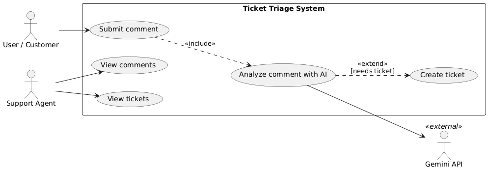

PlantUML source

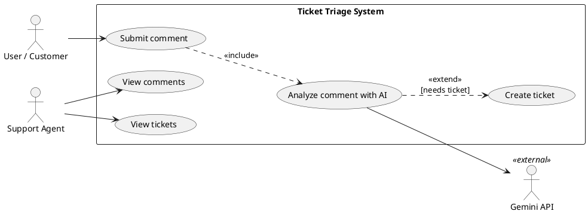

**Mermaid version**

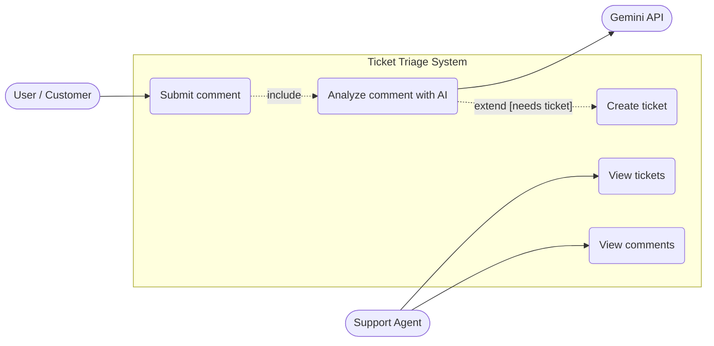

## Component diagram

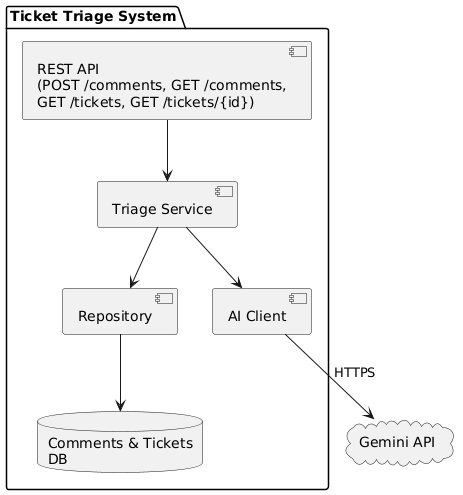

PlantUML source

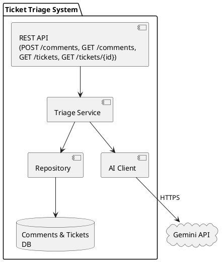

**Mermaid version**

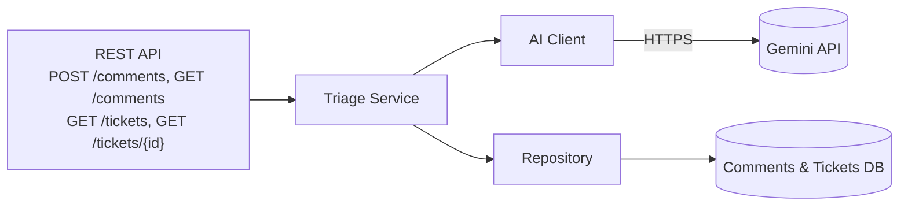

## Class diagram

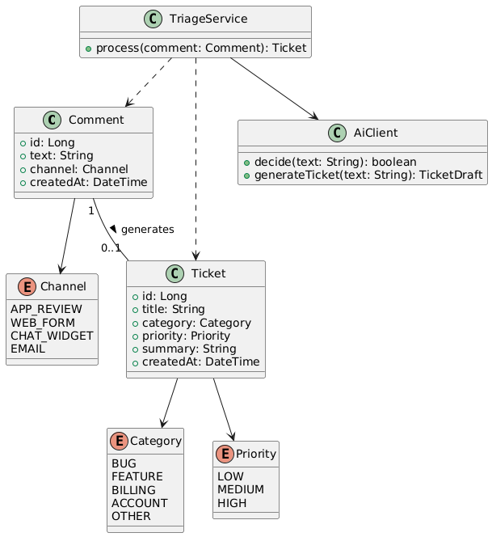

PlantUML source

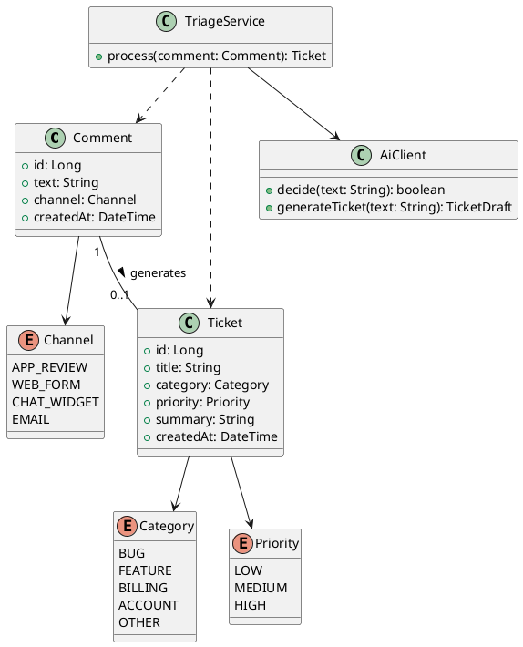

**Mermaid version**

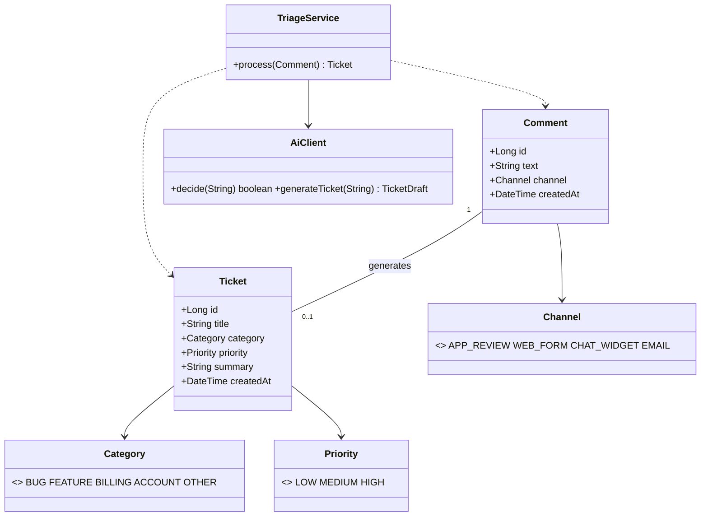

## Sequence diagram – comment submission with AI triage

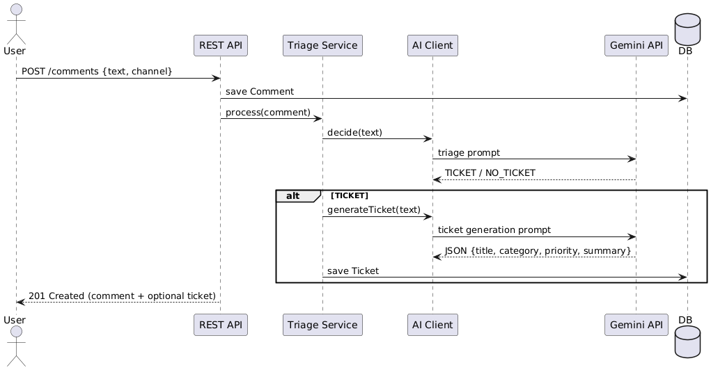

PlantUML source

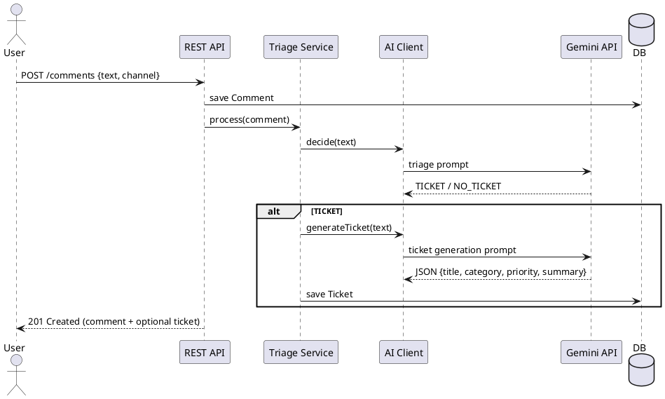

**Mermaid version**

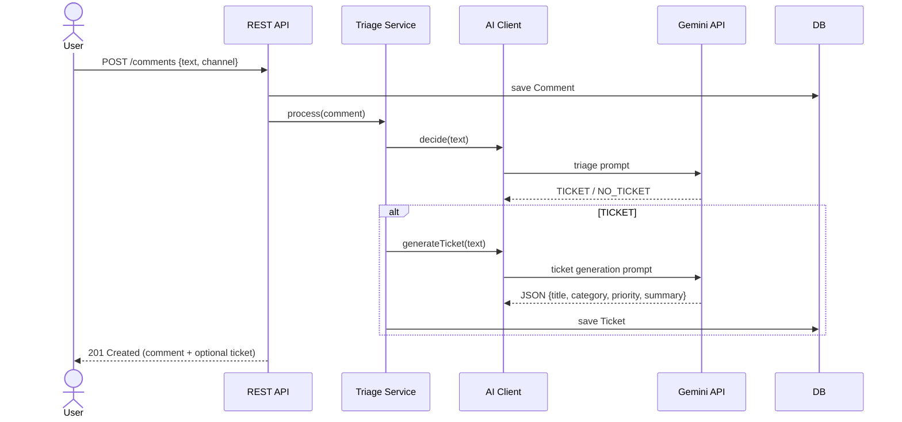

## Activity diagram – triage decision flow

PlantUML source

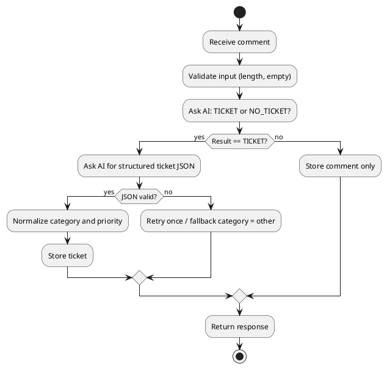

**Mermaid version**

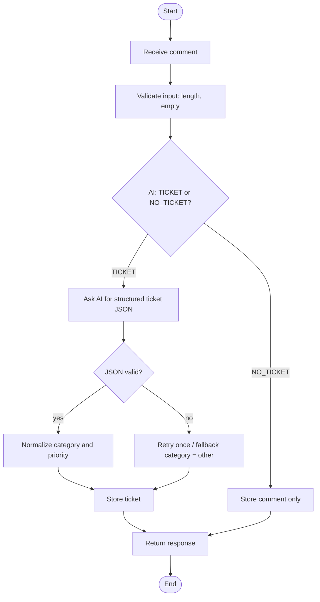
